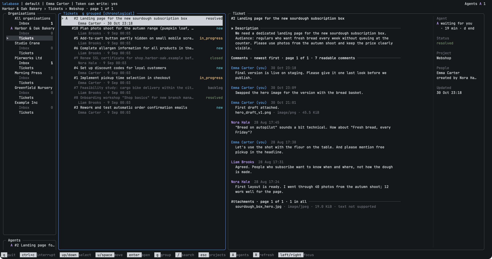

<h1 align="center">Lalabase CLI</h1>

<p align="center">
  <strong>Your Lalabase tickets in the terminal, and Claude Code one key away.</strong>
</p>

<p align="center">
  <a href="LICENSE"></a>
  
  <a href="https://github.com/lalabase/lalabase"></a>
</p>

<p align="center">
  
</p>

`lalabase` is a full-screen terminal client for
[Lalabase](https://github.com/lalabase/lalabase), the self-hosted project
tool for software teams and their clients. It is for developers who live in
the terminal: read your inbox, go through tickets, answer, book your time,
and hand a ticket to [Claude Code](https://claude.com/claude-code) without
opening the browser.

The picture shows the real program with invented data.

## What it is good for

* **Working through your inbox.** The unread notifications of all your
  organisations, with counts. Open the ticket a notification names, mark it
  as read with one key.
* **Reading tickets quickly.** Move through a project's list and the ticket
  appears beside it, with its comments and attachments. Search, or group the
  list by status.
* **Answering and booking without a context switch.** `k` writes a comment,
  `b` books time on the ticket.
* **Handing a ticket to an agent.** `x` starts Claude Code beside the ticket,
  with the ticket as its task and the folder you assigned to that project.
* **Keeping track of several agents.** The client shows which agent is
  working, which waits for your approval and which has finished, across all
  your organisations. One key jumps to an agent or starts it again.

## How it fits with Lalabase

The CLI is a second way into your Lalabase server, not a replacement for it.
Your data stays on the server, and you still need the web app for everything
but the daily work on tickets.

| | Web app | CLI |
|---|---|---|
| Inbox, reading tickets, comments | yes | yes |
| Booking time on a ticket | yes | yes, for today |
| Creating tickets, changing status, title or assignee | yes | not yet |
| Boards, time reports, exports | yes | no |
| Docs, meetings, the AI assistant | yes | no |
| Clients, roles, settings, administration | yes | no |
| Starting and watching Claude Code on a ticket | no | yes |

The core's [MCP server](https://github.com/lalabase/lalabase#what-it-does)
lets an agent reach Lalabase. The CLI adds the part a person needs around it:
it starts the agent on the right ticket and in the right folder, and shows
what it is doing.

## What it does not do

* **No scripting yet.** The client is an interactive program. There is no
  JSON or plain text output, and in a pipe it stops with an error.
* **No ticket management yet.** You cannot create a ticket, or change its
  status, title or assignee. A comment cannot be edited or deleted.
* **Plain text comments only**, and no uploads.
* **No images in the terminal.** A file opens in your browser, which uses
  its own login. The client downloads nothing.
* **No offline mode.** Pages you have seen are shown at once from a cache,
  but every start needs the server.
* **Claude Code only.** `x` starts no other agent.
* **No Windows.** Release builds cover macOS and Linux. Opening panes and
  jumping to them works in iTerm on macOS; elsewhere Claude Code takes over
  the terminal until it ends.

What you see also depends on your server and your token: a key is offered
only when the server supports it and the token may use it. With a read-only
token you can read everything but `r`, `b` and `k` are gone.

## Getting started

You need a Lalabase server, self-hosted or hosted, with an access token you
created in Lalabase. You also need [Go 1.27](https://go.dev/dl/) or newer,
since there is no prebuilt release yet, and for `x`
[Claude Code](https://claude.com/claude-code) on your `PATH`.

**1. Build it.**

```sh
git clone https://github.com/lalabase/lalabase-cli
cd lalabase-cli
go build ./cmd/lalabase
mv lalabase /usr/local/bin/    # or any folder on your PATH
```

**2. Connect it.** If Claude Code already has your Lalabase server, take it
from there. The command lists what it finds, asks which entry to use and
checks the token first:

```sh
lalabase auth import
```

Otherwise create `~/.config/lalabase/config.toml`, readable by you alone
(`chmod 600`, and `chmod 700` for its folder), or the client refuses it:

```toml
[profiles.default]
url = "https://lalabase.example.com"
token = "your-token"
```

**3. Run it.**

```sh
lalabase auth status    # who the token belongs to, what the server supports
lalabase                # open the interface
```

It needs a UTF-8 locale and a terminal of at least 24 columns and 8 rows.
Two columns start at 80, three at 120.

To see it without a server, use the
[stand-in server](docs/reference.md#trying-the-interface-without-a-server).

## Keys

The help line at the bottom always names the keys that work right now.

| Key | Action |
|---|---|
| `↑` `↓` / `Enter` / `Esc` | move / open / go back |
| `←` `→` | move between panes |
| `/` | search the ticket list |
| `g` | group the list by status |
| `[` `]` | previous and next page |
| `Tab` | description, comments, attachments of a ticket |
| `e` | read a long text whole, or fold a group |
| `R` | refresh what is shown |
| `r` | mark a notification as read |
| `k` | write a comment |
| `b` | book time |
| `x` | start Claude Code on the ticket, or jump back to its agent |
| `A` | show the agents |
| `d` | remove an agent |
| `q` | quit |

## Agents and your data

* **An agent has your token's rights.** `x` hands Claude Code the token of
  the profile, write access included. It is asked to treat the ticket as
  foreign text and to ask before changing it. That is a request, not a
  boundary, so use a read-only token if you want one.
* **One server only.** The client talks only to the server
  in your profile. An agent's session sees that server and none of your
  other MCP servers.
* **Your token stays in private files.** The config and the client's files
  under `~/.cache/lalabase` are checked to be yours alone, or the client
  refuses them. The cache keeps ticket text for up to 24 hours.
* **Text from the server is treated as foreign.** Titles, comments and names
  are cleaned before they reach your terminal, so they cannot send it control
  sequences.

## Documentation

* [Reference](docs/reference.md): every key, state, limit and file
* [Development](docs/development.md): how it is built and checked
* [Lalabase](https://github.com/lalabase/lalabase): the main project

## Status

Early. There is no tagged release yet, so build from
`main`. Written in Go without cgo, on
[Bubble Tea](https://github.com/charmbracelet/bubbletea),
[Lip Gloss](https://github.com/charmbracelet/lipgloss) and a few other
libraries, all under permissive licenses (see `go.mod`).

## License

MIT, see [LICENSE](LICENSE). Lalabase itself is AGPL-3.0.
